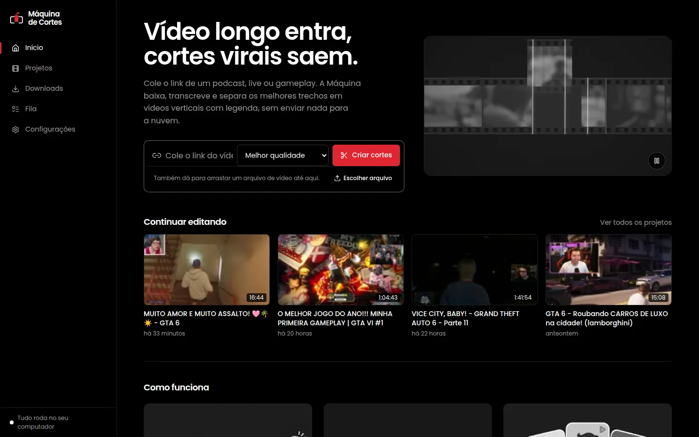
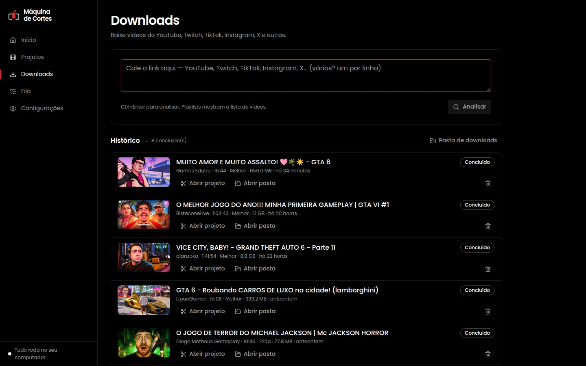
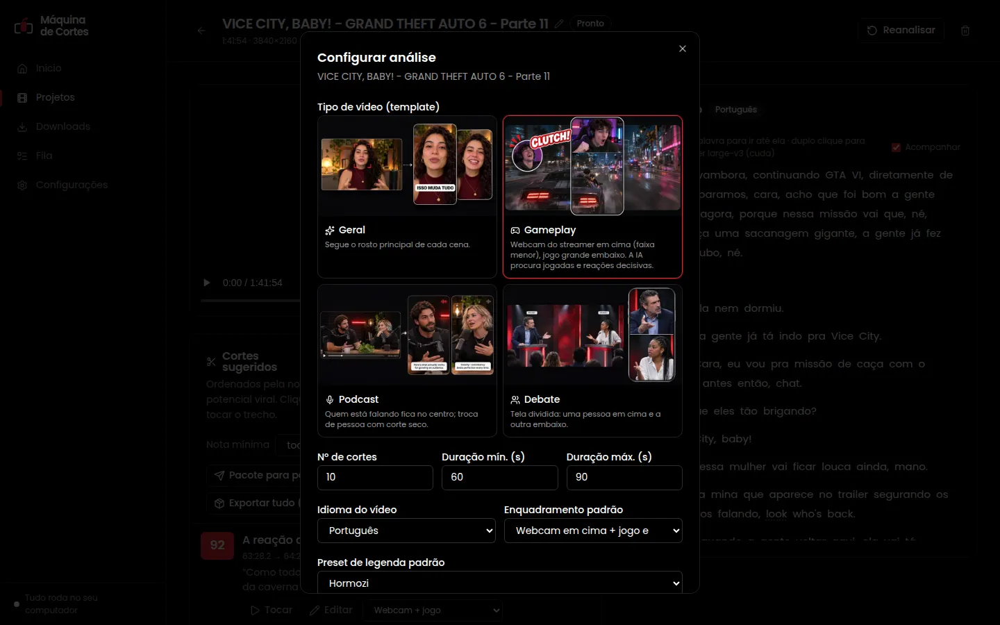
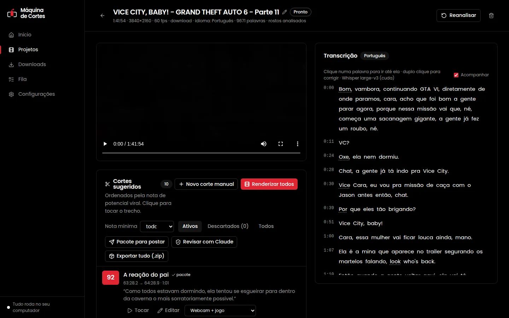
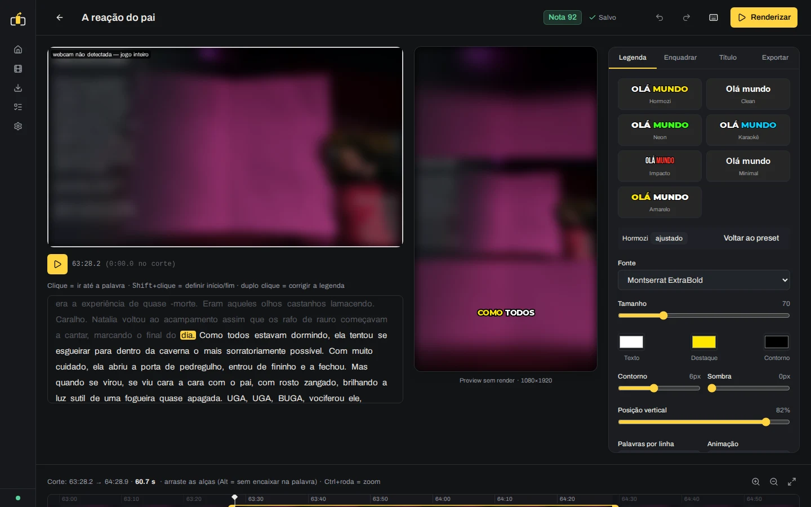
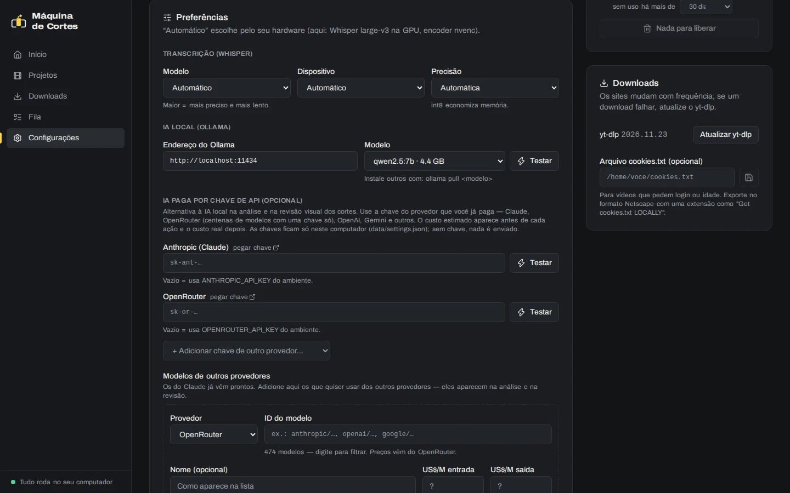
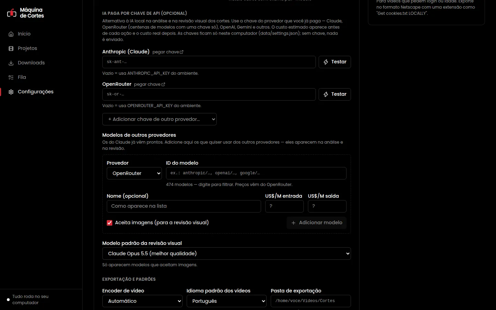
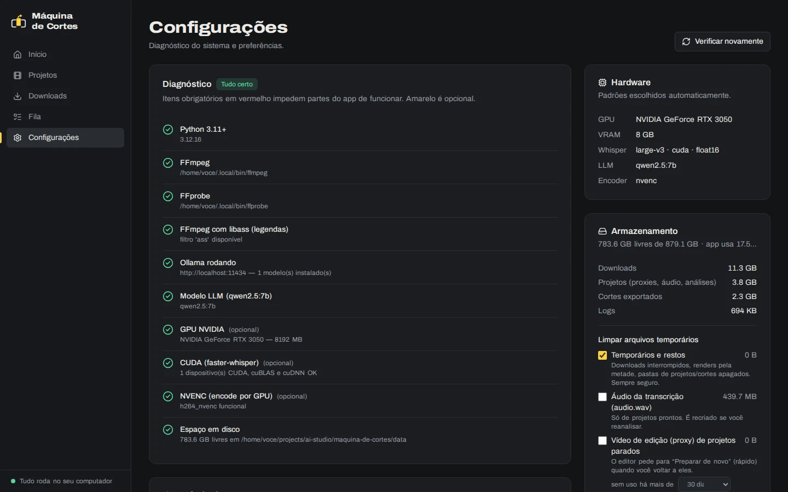
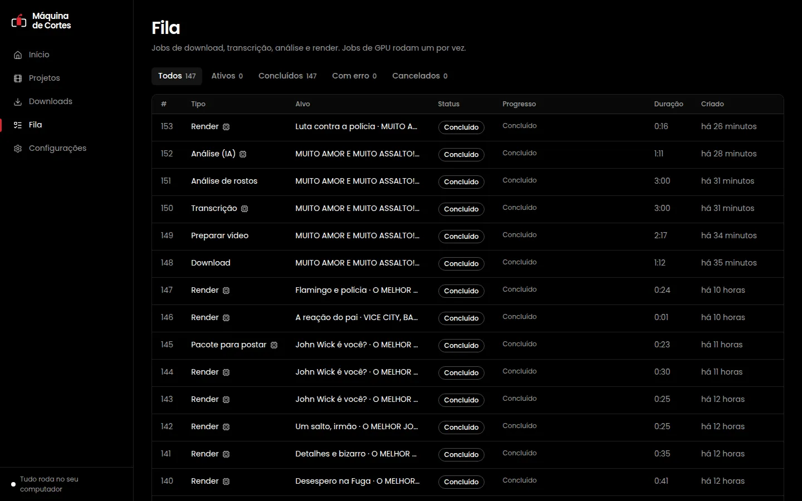

<div align="center">


# Máquina de Cortes ✂️

[Português](README.md) · **English**

**Long video in, viral clips out.**

Turns podcasts, livestreams, lectures and gameplay into **vertical (9:16) clips ready for TikTok, Reels and Shorts**,
with animated captions and automatic framing, **on your own computer**. It's free and your videos never go to the internet.

[Install](#-step-by-step-installation) · [First clip](#-your-first-clip-step-by-step) · [AI models](#-the-ai-models-explained) · [Scripts](#-all-scripts-and-commands) · [Problems?](#-when-something-goes-wrong)

</div>



> **About the language:** the app's interface, its terminal messages and the screenshots are in Brazilian Portuguese.
> In this guide, interface labels are shown as they appear on screen, followed by an English translation in
> parentheses, e.g. **Criar cortes** (Create clips).

---

## Contents

- [What it does](#-what-it-does)
- [Why run it on your computer?](#-why-run-it-on-your-computer)
- [What you need](#-what-you-need)
- [Step-by-step installation](#-step-by-step-installation)
- [Which models should my PC use? (automatic script)](#-which-models-should-my-pc-use)
- [Your first clip, step by step](#-your-first-clip-step-by-step)
- [The editor](#-the-editor)
- [Templates, framing and captions](#-templates-framing-and-captions)
- [The AI models explained](#-the-ai-models-explained)
- [Paid AI (optional)](#-paid-ai-optional)
- [All scripts and commands](#-all-scripts-and-commands)
- [When something goes wrong](#-when-something-goes-wrong)
- [Where files are stored](#-where-files-are-stored)
- [Updating and uninstalling](#-updating-and-uninstalling)
- [FAQ](#-faq)
- [For developers](#-for-developers)
- [Responsible use](#-responsible-use)
- [License](#-license)

---

## ✨ What it does

1. **Downloads** the video from a link (YouTube, Twitch, TikTok, Instagram, X and hundreds of other sites) or uses a file that's already on your computer.
2. **Transcribes** everything that's said, word by word, with the exact timestamp of each one.
3. A **local AI reads the transcript**, picks the best moments and gives each one a **"viral potential" score** from 0 to 100.
4. **Frames it in 9:16** following the face on screen, shows whoever is speaking, splits the screen between two people or builds a "webcam on top + game below" layout.
5. Adds **animated captions** word by word, in the style you choose.
6. You **fine-tune** each clip in a visual editor and **export** the final MP4.
7. The AI also writes a **title, caption and hashtags** for each network and picks the **cover**.

All of this in a browser-based interface (in Portuguese).

## 🔒 Why run it on your computer?

- **Zero cost.** No subscription and no minute limits. The AIs run on your machine.
- **Privacy.** The video and the transcript never leave your computer. (The internet is only used for installation and for downloading videos from links.)
- **No watermark.** The MP4 is yours.

> 💡 If you want, you can use **paid AIs** (Claude, GPT, Gemini, OpenRouter…) with your own key. It's entirely optional, the app always shows the cost upfront and nothing is sent unless you ask. See [Paid AI](#-paid-ai-optional).

---

## 💻 What you need

| | Minimum | Recommended |
|---|---|---|
| **OS** | 64-bit Linux (Ubuntu 22.04 or newer) | Ubuntu 24.04+ |
| **RAM** | 8 GB | 16 GB |
| **Graphics card** | none (runs on the CPU, just slower) | NVIDIA with 6 GB or more (e.g. RTX 2060, 3050, 3060, 4060) |
| **Free space** | 20 GB | 50 GB or more (videos take up a lot) |
| **Internet** | only for installing and downloading videos | |

> **Windows and macOS:** they have their own scripts (see [Windows](#windows) and [macOS](#macos)), but have been **less tested** than Linux.

**Don't know which graphics card or how much memory you have?** No problem: the [`sugerir-modelos`](#-which-models-should-my-pc-use) script figures it out on its own and tells you what to use.

### How long does it take?

For a **1 hour** video, the full analysis (prepare + transcribe + AI picks the clips) takes roughly:

| Computer | Approximate time |
|---|---|
| 8 GB NVIDIA (e.g. RTX 3050) | **~15 minutes** |
| 4 GB NVIDIA | ~20–25 minutes |
| CPU only, 8 cores and 16 GB | ~50 minutes |
| CPU only, basic laptop | 1–2 hours |

Before starting, the app shows a **time estimate** for your video and your computer. Once it's done, each clip renders in 10–30 seconds with NVIDIA.

---

## 🚀 Step-by-step installation

> You only do this **once**. After that, to open the program, you only need [step 5](#5-open-the-program).

### Linux (Ubuntu and derivatives)

#### 1. (NVIDIA cards only) Install the driver

If your computer has an **NVIDIA** graphics card, install the driver **before** anything else:

1. Open the applications menu and search for **"Software & Updates"**.
2. Go to the **"Additional Drivers"** tab.
3. Choose the **`nvidia-driver-XXX`** driver marked as *recommended* (or *proprietary, tested*).
4. Click **Apply Changes** and **restart the computer**.

To check that it worked, open the Terminal and type `nvidia-smi`. If a table with your card's name shows up, you're all set.

> No NVIDIA? Skip this step. The program still works, just slower.

#### 2. Download the project

**Option A, no git knowledge needed (easiest):**

1. On the project's GitHub page, click the green **`<> Code`** button and then **Download ZIP**.
2. Extract the ZIP (right-click → **Extract Here**).
3. Inside the extracted folder, open the **`maquina-de-cortes`** folder.

**Option B, with git:**

```bash
git clone https://github.com/Gustavo-2514/ai-studio.git
cd ai-studio/maquina-de-cortes
```

#### 3. Open the Terminal inside the `maquina-de-cortes` folder

- Easiest way: open the `maquina-de-cortes` folder in the file manager, **right-click on an empty area** and choose **"Open in Terminal"**.
- Or: open the Terminal (`Ctrl` + `Alt` + `T`), type `cd ` (with a trailing space), **drag the `maquina-de-cortes` folder into the window** and press `Enter`.

To check you're in the right folder, type `ls` and press `Enter`: you should see `backend`, `frontend`, `scripts` and `run.py`.

#### 4. Run the installer

Copy the line below, paste it into the Terminal (`Ctrl` + `Shift` + `V`) and press `Enter`:

```bash
scripts/setup.sh
```

The installer does everything by itself, **without asking for a password** (it only installs inside your home folder), and shows progress in 5 steps:

| Step | What happens |
|---|---|
| **1/5 Tools** | installs whatever is missing: Python (via `uv`), FFmpeg, Node.js and Ollama |
| **2/5 Python environment** | installs the program's libraries in a `.venv` folder |
| **3/5 Interface** | builds the app's screens |
| **4/5 AI models** | downloads the transcription model and the AI model **right for your computer** (~8 GB the first time) |
| **5/5 Diagnostics** | checks that everything is working |

⏱️ It takes **10 to 40 minutes**, depending on your internet. You can leave it running.

At the end you should see something like this (the installer's output is in Portuguese; "Tudo pronto!" means "All set!"):

```text
  ✓ Python 3.11+: 3.12.x
  ✓ FFmpeg: /home/voce/.local/bin/ffmpeg
  ✓ Ollama rodando: http://localhost:11434 — 1 modelo(s) instalado(s)
  ✓ Modelo LLM (qwen2.5:7b): qwen2.5:7b
  ✓ GPU NVIDIA: NVIDIA GeForce RTX 3050 — 8192 MB
  ...
  Tudo pronto!
```

> **Slow internet?** Use `scripts/setup.sh --sem-modelos` ("no models"). It installs everything except the models, which download on their own on first use.
>
> **Got "Precisa do zstd" or "Precisa do curl" ("zstd/curl is required")?** Run `sudo apt install zstd curl` and then `scripts/setup.sh` again.

#### 5. Open the program

```bash
scripts/start.sh
```

The browser opens automatically at **http://localhost:8000**. If it doesn't, type that address into your browser.

- **To close it:** go back to the Terminal and press `Ctrl` + `C`.
- **To open it again another day:** open the Terminal in the folder (step 3) and run `scripts/start.sh`.
- **Don't close the Terminal** while using the program: it's what keeps the app running.

### Windows

> ⚠️ **Untested.** Development was done on Linux. If something goes wrong, open an *issue* on GitHub.

1. (If you have NVIDIA) Update the driver through **GeForce Experience** or at [nvidia.com/drivers](https://www.nvidia.com/Download/index.aspx).
2. Download the project (**Code → Download ZIP** button) and extract it.
3. Open the `maquina-de-cortes` folder, click the Explorer's **address bar**, type `powershell` and press `Enter`.
4. Run the installer (it uses `winget` to install FFmpeg, Node.js and Ollama):
   ```powershell
   powershell -ExecutionPolicy Bypass -File scripts\setup.ps1
   ```
5. To open the program, double-click **`scripts\start.bat`** (or run `scripts\start.bat` in PowerShell).

### macOS

> ⚠️ **Barely tested.** Macs have no NVIDIA: transcription runs on the CPU. On Macs with Apple chips (M1, M2, M3…), the clip-picking AI uses the chip's GPU.

1. Install [Homebrew](https://brew.sh) and then, in the Terminal: `brew install ffmpeg node`
2. Install Ollama: [ollama.com/download](https://ollama.com/download)
3. In the `maquina-de-cortes` folder: `scripts/setup.sh` and then `scripts/start.sh`.

---

## 🧠 Which models should my PC use?

The program uses **two AI models** that run on your computer: one that **transcribes** (Whisper) and another that **picks the clips** (Ollama). Bigger models are better but need more memory.

So you don't have to guess, run:

```bash
scripts/sugerir-modelos.sh
```

> Windows: `scripts\sugerir-modelos.bat`. It works even **before** installing (it only needs Python).

It looks at your **graphics card, RAM, CPU and disk space** and explains what to use and why. Example output (in Portuguese, as the script prints it):

```text
Seu computador
  Sistema       Linux 7.0.0-44-generic
  Processador   AMD Ryzen 5 5600G with Radeon Graphics (12 núcleos)
  Memória RAM   14 GB
  Placa vídeo   NVIDIA GeForce RTX 3050 — 8 GB
  Disco livre   784 GB

Sugestão
  Transcrição (Whisper): large-v3  [placa de vídeo · float16 · ~3.1 GB]
     Por quê: a melhor precisão; cabe na sua placa e transcreve 1 hora de vídeo em poucos minutos.
     Alternativa: turbo — quase a mesma qualidade e ~2× mais rápido.
  IA que escolhe os cortes (Ollama): qwen2.5:7b  [~4.7 GB]
     Por quê: cabe inteiro na placa de vídeo (NVIDIA); é o modelo padrão e o mais testado com o app.
     Alternativa: qwen2.5:3b — se a análise ficar lenta ou faltar memória.
  Codificação do vídeo: nvenc (o app escolhe sozinho)

Próximos passos
  ✓ O modelo qwen2.5:7b já está instalado no Ollama.
  • Usar estes modelos no app: rode este script com --aplicar
```

In short: it suggests Whisper `large-v3` on the GPU (best accuracy, fits the card) with `turbo` as an alternative, and `qwen2.5:7b` for picking clips (fits entirely on the GPU, the default and most tested model) with `qwen2.5:3b` as an alternative.

Like the suggestion? Apply it with:

```bash
scripts/sugerir-modelos.sh --aplicar
```

This saves the models in the app's Settings and asks whether it can download the AI model (if it isn't installed yet).

| Option | What it does |
|---|---|
| *(none)* | only shows the suggestion, changes nothing |
| `--aplicar` ("apply") | saves the suggestion in the app and offers to download the model |
| `--aplicar --sim` ("apply --yes") | same, but without asking (good for automation) |
| `--json` | prints everything as JSON, for other programs |

> The installer and the app **already pick models automatically** based on your hardware. The script is for you to **understand** the choice, see alternatives and make the most of bigger cards (for example, suggesting `qwen2.5:14b` on a card with 16 GB or more).

### Quick suggestion table

| Your computer | Transcription (Whisper) | Clip AI (Ollama) |
|---|---|---|
| NVIDIA with 16 GB or more (RTX 4080, 4090, 3090…) | `large-v3` on the GPU | `qwen2.5:14b` |
| NVIDIA with 8–12 GB (RTX 3050 8 GB, 3060, 4060, 4070…) | `large-v3` on the GPU | `qwen2.5:7b` ⭐ default |
| NVIDIA with 6 GB (RTX 2060, 3050 6 GB…) | `large-v3` on the GPU | `qwen2.5:3b` (or `7b`, a bit slower) |
| NVIDIA with 4 GB (GTX 1650, 3050 laptop…) | `medium` on the GPU | `qwen2.5:3b` |
| AMD card (Linux) | `small` on the CPU | depending on the card's memory |
| Mac with Apple chip, 16 GB+ | `small` on the CPU | `qwen2.5:7b` |
| CPU only, 16 GB RAM | `small` | `qwen2.5:3b` |
| CPU only, 8 GB RAM | `base` | `qwen2.5:3b` |
| Less than 8 GB RAM | `base` | `qwen2.5:1.5b` (or [paid AI](#-paid-ai-optional)) |

---

## 🎬 Your first clip, step by step

### Fastest way: from the Home screen

On the **Início** (Home) screen, paste the video link and click **Criar cortes** (Create clips). The app downloads, transcribes and analyzes it on its own. You can also **drag a video file** into the box or click **Escolher arquivo** (Choose file).

### Full way: choosing the download quality

**1. Download the video.** Go to **Downloads**, paste the link (it can be more than one, one per line) and click **Analisar** (Analyze). Choose the quality and click **Baixar** (Download). Playlists show the list of videos for you to choose from.



**2. Create the clips.** When the download finishes, click **Abrir projeto** (Open project) or **Criar cortes** (Create clips).

**3. Configure the analysis.** In the **Configurar análise** (Configure analysis) window, choose:

- **Video type (template):** General, Gameplay, Podcast or Debate ([what changes?](#templates-choose-by-video-type));
- **Number of clips** and the minimum and maximum **duration** of each one (in seconds);
- **Video language:** Portuguese, English, Spanish or auto-detect;
- **Caption style**;
- **Which AI picks the clips**: the local one (free) or a [paid one](#-paid-ai-optional);
- **Extra instructions** (optional), for example: *"focus on the funny parts"* or *"avoid sponsor segments"*.

The app shows the **estimated time** before starting. Click **Analisar** (Analyze).



**4. Wait for the analysis.** You can follow the progress on the project page or in the **Fila** (Queue): prepare the video → transcribe → the AI reads the excerpts. You can close the browser tab and the work keeps going (just don't close the Terminal).

**5. Look at the suggested clips.** They're sorted by score, best to worst. Click **Tocar** (Play) to watch the excerpt and **Por quê?** (Why?) to see the reason it was picked. On the right is the full transcript: click any word to jump to it.



**6. Fine-tune in the editor** (optional). Click **Editar** (Edit) to change the start and end, captions, framing and title. See [The editor](#-the-editor).

**7. Render.** Click **Renderizar** (Render) on a clip or **Renderizar todos** (Render all). Then use **Baixar** (Download) or **Abrir pasta** (Open folder) to get the MP4s.

**8. Posting pack.** Click **Pacote para postar** (Posting pack): the AI writes a **title, caption and hashtags** for TikTok, Reels and Shorts and picks the **cover** for each clip (the sharpest frame with a face, in a clean version and one with the title). On each clip, **Postar** (Post) shows the texts (editable) with a **Copiar** (Copy) button per platform.

**9. Export all (.zip).** **Exportar tudo (.zip)** downloads the MP4s + the covers + `textos.csv` (opens in Excel or Google Sheets) + `textos.txt` (for copy and paste).

> The app **doesn't post anything by itself** to any social network. You post when and where you want.

### Other ways to start

- **A video already on your computer:** **Projetos → Novo projeto → Enviar arquivo** (Projects → New project → Upload file), or **Caminho local** (Local path — doesn't copy the file, saves space).
- **A clip from scratch, chosen by you:** on the project page, **Novo corte manual** (New manual clip).
- **Don't like a clip?** **Descartar** (Discard) removes it from the list (you can recover it under **Descartados** / Discarded). **Duplicar** (Duplicate) creates a copy to try another version.

---

## 📝 The editor



The editor has four areas:

- **Left:** the original video and the clip's transcript. Click a word to jump to it, **Shift+click** to mark the start or end and **double-click** to fix a wrong word in the captions.
- **Center:** the vertical (9:16) preview of how the clip will look, captions included.
- **Right, tabs:**
  - **Legenda** (Captions): choose the style and adjust font, size, colors, outline, shadow, position, words per line and animation.
  - **Enquadrar** (Framing): choose the framing mode and adjust it by hand (drag and resize).
  - **Título** (Title): fixed text at the top of the video (optional).
  - **Exportar** (Export): options for the final file.
- **Bottom:** the timeline with the audio waveform. Drag the yellow handles to change the start and end (they "snap" to the start of words; hold `Alt` to release). `Ctrl` + mouse wheel zooms.

The editor **saves automatically** ("Salvo" — Saved — appears at the top). When you're done, click **Renderizar** (Render).

### Keyboard shortcuts

| Key | What it does |
|---|---|
| `Space` | play / pause |
| `←` / `→` | step 1 frame (with `Shift`: 1 second) |
| `I` / `O` | mark the clip's start / end at the current position |
| `J` / `K` / `L` | back 2 s / pause / play (press `L` again for 2×) |
| `Ctrl+Z` / `Ctrl+Shift+Z` | undo / redo |
| `Ctrl+S` | save now |
| `Ctrl+Enter` | render |
| `?` | show all shortcuts |

---

## 🎨 Templates, framing and captions

### Templates: choose by video type

The template changes **how the clip is framed** and **what the AI looks for**:

| Template | How the clip looks | What the AI looks for |
|---|---|---|
| **Geral** (General) | follows the main face | the best moments in general |
| **Gameplay** | streamer's webcam on top, big game view below | decisive plays and strong reactions (screams, laughter) |
| **Podcast** | whoever is speaking stays in the center, with a hard cut on each switch | strong opinions, stories, punchlines |
| **Debate** | split screen: one person on top, the other below | confrontations, rebuttals, disagreements |

### Framing modes

Each clip can use a different mode (choose it in the clip list or in the editor's **Enquadrar** / Framing tab):

| Mode | When to use it |
|---|---|
| **Seguir rosto** (Follow face) | the default. Follows whoever is on screen and cuts hard when the camera changes |
| **Quem fala no centro** (Speaker in center) | podcast/interview: reads lip movement and shows whoever is speaking |
| **Webcam + jogo** (Webcam + game) | gameplay with a facecam (you can drag and resize the webcam and the game) |
| **Tela dividida** (Split screen) | two people in the same scene: the one on the left goes on top, the one on the right below |
| **Inteiro + fundo borrado** (Full + blurred background) | screens, slides and games without a webcam, where the sides can't be cropped |
| **Centro** (Center) / **Manual** | when you want to control the framing |

### Caption styles

**Hormozi**, **Clean**, **Neon**, **Karaokê** (Karaoke), **Impacto** (Impact), **Minimal** and **Amarelo** (Yellow). All of them highlight the spoken word in real time and can be adjusted in the editor (font, colors, size, position, animation). Adjustments apply only to that clip; **Voltar ao preset** (Back to preset) undoes them.

---

## 🤖 The AI models explained

The app uses several small AIs, each with one task. **All of them run on your computer.**

| Task | Model | Runs on | Needs downloading? |
|---|---|---|---|
| Transcribing speech | **Whisper** (via [faster-whisper](https://github.com/SYSTRAN/faster-whisper)) | NVIDIA card or CPU | yes, the installer downloads it |
| Picking clips, scoring, writing posting texts | **Qwen 2.5** (via [Ollama](https://ollama.com)) | graphics card (NVIDIA, AMD, Apple) or CPU | yes, the installer downloads it |
| Finding faces | **YuNet** (OpenCV) | CPU | no, it's bundled |
| Knowing who is speaking (lips) | **MediaPipe Face Landmarker** | CPU | no, it's bundled |
| Detecting camera changes | **PySceneDetect** | CPU | no (it's not AI, it's image analysis) |

### Whisper: transcription

Whisper listens to the audio and writes down what was said, with the timestamp of each word. That's what keeps the captions in sync. The bigger the model, the fewer mistakes and the slower it is.

| Model | Size | Quality in Portuguese | Needs |
|---|---|---|---|
| `tiny` | 75 MB | poor (many mistakes) | any computer |
| `base` | 145 MB | fair | any computer |
| `small` | 0.5 GB | good | ⭐ default without NVIDIA |
| `medium` | 1.5 GB | very good | NVIDIA with 4 GB or a strong CPU (slow) |
| `turbo` | 1.6 GB | great, fast | NVIDIA with 4 GB+ |
| `large-v3` | 3.1 GB | **the best** | ⭐ default with NVIDIA 6 GB+ |

- **Device:** `cuda` = NVIDIA card (fast); `cpu` = processor. AMD cards and Macs use the CPU for transcription.
- **Precision:** `float16` (best, on the GPU), `int8_float16` (saves GPU memory), `int8` (on the CPU).
- In **Automático** (Automatic) mode the app chooses by itself. If the model can't load on the GPU (out of memory, driver), the app uses the CPU with `small`.

### Ollama + Qwen 2.5: the AI that picks the clips

[Ollama](https://ollama.com) is a program that runs language models (like a local "ChatGPT"). The app sends it the transcript, in chunks of ~8 minutes, and asks for the excerpts with the most potential, with a score and the reason. The same model writes the **Posting pack** texts.

The default model is **Qwen 2.5** (from Alibaba), chosen because it's good at Portuguese and follows the response format the app expects well.

| Model | Download | Clip quality | Needs (GPU memory, or RAM without a GPU) |
|---|---|---|---|
| `qwen2.5:1.5b` | 1.0 GB | basic | 4 GB RAM |
| `qwen2.5:3b` | 1.9 GB | good | 6 GB on the GPU or 8 GB RAM |
| `qwen2.5:7b` | 4.7 GB | **very good** ⭐ default, the most tested | 8 GB on the GPU |
| `qwen2.5:14b` | 9.0 GB | great | 16 GB on the GPU |
| `qwen2.5:32b` | 20 GB | excellent | 24–32 GB on the GPU |

> **About GPU memory:** Whisper and Qwen don't need to fit together. On cards with less than 10 GB, the app unloads Whisper before calling the AI (and vice versa).

### How to switch models

**In the app:** **Configurações → Preferências** (Settings → Preferences).

- **Transcrição (Whisper):** choose the model, device and precision. *Automático* decides based on the hardware.
- **IA local (Ollama)** (Local AI): the list shows the installed models. Click **Testar** (Test) to check that it responds and how long it takes.



**To install another model in Ollama**, run in the Terminal (replace with the model name):

```bash
ollama pull qwen2.5:3b
```

It then appears in the list under **Configurações** (Settings). To see the installed models: `ollama list`. To delete one: `ollama rm qwen2.5:14b`.

> Other models from the [Ollama catalog](https://ollama.com/library) (Llama, Gemma, Mistral…) also work, but **haven't been tested**. If the analysis fails with an "invalid response" error, go back to Qwen 2.5.

**Or use the script:** `scripts/sugerir-modelos.sh --aplicar` ([see above](#-which-models-should-my-pc-use)).

### Encoding the final video

To generate the MP4, the app uses **NVENC** (the NVIDIA card's video chip, very fast) when it exists and works, and **x264** (CPU) when it doesn't. The quality is the same. Audio is normalized to −14 LUFS, the standard volume for social networks.

---

## 💳 Paid AI (optional)

If you already pay for an AI or want even better results, you can swap the local AI for a paid one **in two tasks**:

1. **Picking the clips** (in the **Configurar análise** / Configure analysis window, *IA que escolhe os cortes* / AI that picks the clips field);
2. **Visual review** of rendered clips (**Revisar com Claude** / **Revisar** — Review): the AI looks at 8 frames of the final MP4 and points out problems such as a cropped face, captions covering something, a weak hook or an ending mid-sentence.

Supported providers: **Anthropic (Claude)**, **OpenRouter** (hundreds of models with a single key), **OpenAI**, **Google Gemini**, **DeepSeek**, **xAI (Grok)**, **Groq**, **Mistral** and **any OpenAI-compatible API** (LM Studio, Together…).



### How to set it up

1. Create an API key on the provider's website (the **pegar chave** / get key link next to each field goes straight to the right page).
2. In **Configurações → IA paga por chave de API** (Settings → Paid AI by API key), paste the key and click **Testar** (Test).
3. **Claude** models come preconfigured. For other providers, add the model under **Modelos de outros provedores** (Models from other providers) — on OpenRouter, type to search: the price is filled in automatically.
4. When analyzing, choose the model in the *IA que escolhe os cortes* (AI that picks the clips) list.

### Cost and privacy

- The app **shows the estimated cost before** each paid action and the **actual cost** afterwards. To give you an idea, analyzing a 1 hour video costs from **cents** (cheap models, such as Claude Haiku) to **a few dollars** (the biggest ones).
- Keys stay **only on your computer**, in `data/settings.json`. You can also use environment variables (`ANTHROPIC_API_KEY`, `OPENROUTER_API_KEY`, `OPENAI_API_KEY`, `GEMINI_API_KEY`…).
- Without a key, **nothing is sent** anywhere. With a key, only the transcript (and, for the visual review, the 8 frames) goes to the chosen provider.

---

## 🧰 All scripts and commands

Always run them **inside the `maquina-de-cortes` folder**.

### Main scripts

| Linux / macOS | Windows | What it's for |
|---|---|---|
| `scripts/setup.sh` | `powershell -ExecutionPolicy Bypass -File scripts\setup.ps1` | installs everything (run it again to update) |
| `scripts/setup.sh --sem-modelos` | `... scripts\setup.ps1 -SemModelos` | installs without downloading the AI models |
| `scripts/start.sh` | `scripts\start.bat` | opens the program at http://localhost:8000 |
| `scripts/sugerir-modelos.sh` | `scripts\sugerir-modelos.bat` | suggests AI models for your PC |
| `scripts/sugerir-modelos.sh --aplicar` | `scripts\sugerir-modelos.bat --aplicar` | applies the suggestion and downloads the model |

### Advanced commands (`run.py`)

`start.sh` calls `run.py`. You can also call it directly (Windows: replace `.venv/bin/python` with `.venv\Scripts\python.exe`):

| Command | What it does |
|---|---|
| `.venv/bin/python run.py` | opens the program (same as `start.sh`) |
| `.venv/bin/python run.py --no-browser` | starts without opening the browser (useful on a server) |
| `.venv/bin/python run.py --diagnostico` | shows the diagnostics (FFmpeg, Ollama, GPU…) and exits |
| `.venv/bin/python run.py --baixar-modelos` | downloads the models suited to the hardware and exits |
| `.venv/bin/python run.py --dev` | developer mode, with hot reload (interface at http://localhost:5173) |

`scripts/start.sh` accepts the same options: `scripts/start.sh --no-browser`.

### Environment variables (optional)

| Variable | Default | What it's for |
|---|---|---|
| `MDC_PORT` | `8000` | the program's port (e.g. `MDC_PORT=8001 scripts/start.sh`) |
| `MDC_HOST` | `127.0.0.1` | address. Use `0.0.0.0` to open it from another computer on the network (**careful**: there's no password) |
| `MDC_DATA_DIR` | `./data` | folder where videos, projects and clips are stored (e.g. on an external drive) |
| `OLLAMA_HOST_URL` | `http://127.0.0.1:11434` | where Ollama is running |
| `ANTHROPIC_API_KEY`, `OPENROUTER_API_KEY`, `OPENAI_API_KEY`… | — | [paid AI](#-paid-ai-optional) keys, instead of pasting them in Settings |

Variables starting with `MDC_` can also go in a `.env` file inside the `maquina-de-cortes` folder (one per line, e.g. `MDC_PORT=8001`).

---

## 🩺 When something goes wrong

**The first place to look is Configurações → Diagnóstico (Settings → Diagnostics).** It shows ✅ or ❌ for each piece and tells you how to fix it. Items marked as *opcional* (optional) don't prevent the app from working.



| Problem | Solution |
|---|---|
| `scripts/setup.sh: Permission denied` | run `chmod +x scripts/*.sh` and try again |
| "Precisa do zstd" / "Precisa do curl" (zstd/curl required) | `sudo apt install zstd curl` and run `setup.sh` again |
| YouTube download fails | **Configurações → Atualizar yt-dlp** (Settings → Update yt-dlp), then close and reopen the app |
| "O site pediu login" (the site asked for login) / age restriction | export a `cookies.txt` from your browser (the "Get cookies.txt LOCALLY" extension) and set its path in **Configurações → Downloads** |
| "A placa de vídeo ficou sem memória" (GPU out of memory) | close games and heavy programs, or choose smaller models (run `scripts/sugerir-modelos.sh`) |
| "O Ollama não está respondendo" (Ollama isn't responding) | close and reopen the app (it starts Ollama by itself); in **Configurações**, click **Testar** (Test) |
| The AI returned an invalid response | try again; if it repeats, use a bigger model or go back to `qwen2.5:7b` |
| Very slow | without NVIDIA everything runs on the CPU. Use Whisper `small` or `base` and `qwen2.5:3b` |
| The NVIDIA card doesn't show up in Diagnostics | install the driver (see [installation](#1-nvidia-cards-only-install-the-driver)) and restart; check with `nvidia-smi` |
| "Porta 8000 em uso" (port 8000 in use) | the app is already open in another window, or run `MDC_PORT=8001 scripts/start.sh` and open http://localhost:8001 |
| Disk full | **Configurações → Armazenamento → Liberar** (Settings → Storage → Free up) |
| The page doesn't open | check that the Terminal running `start.sh` is still open and without errors |

Every failed task shows up in the **Fila** (Queue) with an explanation. **Detalhe técnico** (Technical details) has the full message, useful when asking for help. Logs are kept in `data/logs/`.



**Still stuck?** Open an *issue* on GitHub with: your OS (Ubuntu 24.04, Windows 11…), graphics card, the output of `.venv/bin/python run.py --diagnostico` and the error's **Detalhe técnico** (Technical details).

---

## 📁 Where files are stored

Everything lives inside the `data/` folder (or the folder set in `MDC_DATA_DIR`):

| Folder | Contents |
|---|---|
| `data/downloads/` | downloaded videos |
| `data/projects/` | each project's working files (can be cleaned in **Configurações → Armazenamento** / Settings → Storage) |
| `data/exports/` | **the finished clips (MP4)**, or the folder you choose in **Configurações** (Settings) |
| `data/logs/` | diagnostic logs |
| `data/settings.json` | your preferences (and API keys, if you use them) |
| `data/app.db` | database with projects and clips |

The AI models live outside the project: Whisper in `~/.cache/huggingface` and Ollama in `~/.ollama/models`.

---

## 🔄 Updating and uninstalling

**Updating:**

- If you downloaded with git: `git pull` inside the folder and then `scripts/setup.sh`.
- If you downloaded the ZIP: download the new ZIP, **copy your `data/` folder** into the new folder and run `scripts/setup.sh`.

**Uninstalling:**

1. Delete the `maquina-de-cortes` folder (the `data/` folder inside it has your videos and clips: back it up first if you want).
2. To also remove the tools and models: delete `~/.local/opt/` (FFmpeg, Node and Ollama installed by the setup), `~/.ollama/models` (AI models) and `~/.cache/huggingface` (Whisper).

---

## ❓ FAQ

**Is it really free?**
Yes. Everything runs on your computer. It only costs money if you choose to use a [paid AI](#-paid-ai-optional), with your own key.

**Do I need internet?**
Only for installing and for downloading videos from links. With the video on your computer, you can work offline.

**Do my videos go to any server?**
No. Nothing leaves your computer, unless you set up a paid AI (then only the transcript goes to the provider you chose).

**Does it work without a graphics card?**
Yes, it just takes longer. Run `scripts/sugerir-modelos.sh` to choose lightweight models.

**Does it post to social networks?**
No. It prepares the videos, covers and texts. You post them.

**Does it work with videos in English or Spanish?**
Yes. In the analysis you can choose Portuguese, English, Spanish or **Detectar automaticamente** (Auto-detect). The interface is in Portuguese.

**What's the maximum video length?**
There's no fixed limit. It has been used with nearly 2-hour livestreams in 4K. Longer videos just take more time and disk space.

**Can I use it on my phone?**
Not directly: the app runs on the computer. But if you start it with `MDC_HOST=0.0.0.0`, you can access it from the browser of another device on the same Wi-Fi network (no password, so only on a trusted network).

---

## 🔧 For developers

- **Backend:** Python 3.12, FastAPI + SQLite (SQLModel) + a custom worker that runs heavy tasks one at a time on the GPU (`backend/app`).
- **Frontend:** React + Vite + TypeScript + Tailwind (`frontend/src`).
- **Media:** FFmpeg (cutting, ASS captions via libass, NVENC), yt-dlp (downloads), faster-whisper (transcription), Ollama (LLM), OpenCV YuNet + MediaPipe (faces and lips), PySceneDetect (scenes).

```text
maquina-de-cortes/
├── backend/app/
│   ├── api/          HTTP routes (projects, clips, downloads, queue, system)
│   ├── services/     transcription, AI, framing, render, captions, posting pack…
│   └── worker/       task queue (download, transcription, analysis, render)
├── frontend/src/     interface (pages, editor, components)
├── scripts/          installers, startup and model suggestions
├── docs/img/         screenshots used in this README
└── run.py            starts API + worker + Ollama together
```

- **Development mode** (hot reload): `.venv/bin/python run.py --dev` → interface at http://localhost:5173.
- **Tests:** `cd backend && ../.venv/bin/pytest` and `cd frontend && npm test`.
- **Implementation decisions and measurements:** [`DECISIONS.en.md`](DECISIONS.en.md). Original specification: [`../MAQUINA_DE_CORTES.en.md`](../MAQUINA_DE_CORTES.en.md).

Contributions are welcome! Read the [contribution guide](../CONTRIBUTING.en.md): it explains how to set up the environment, the *pull request* workflow and the commit convention ([Conventional Commits](https://www.conventionalcommits.org/en/v1.0.0/), in English). Testing on Windows and macOS helps a lot.

---

## 🤝 Responsible use

Only download and clip content you have the right to use: your own, licensed, or with the creator's permission. Many platforms only allow monetizing third-party clips with authorization, and some creators have their own rules for clip channels.

---

## 📄 License

[MIT](../LICENSE): you can use, modify and distribute it, including commercially, as long as you keep the copyright notice.
The changes in each version are in the [CHANGELOG](../CHANGELOG.en.md).

---

<div align="center">

Made by [Gustavo Albuquerque](https://github.com/Gustavo-2514).
If the project helped you, leave a ⭐ on GitHub!

</div>
