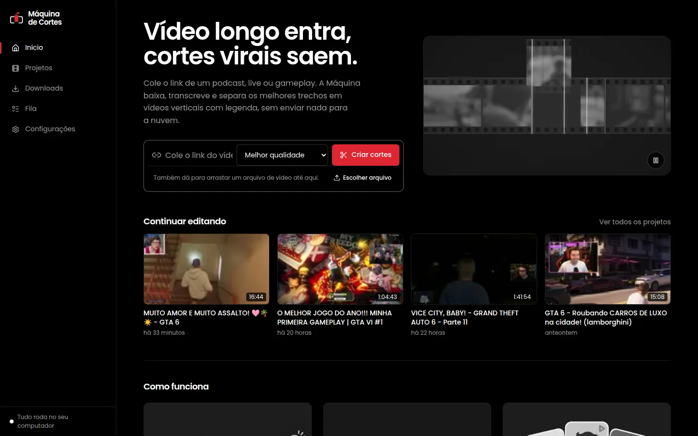
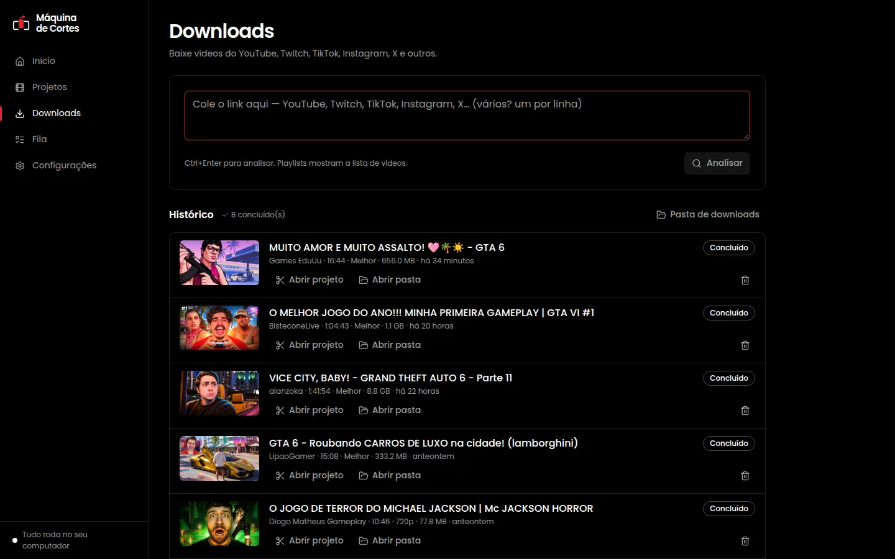
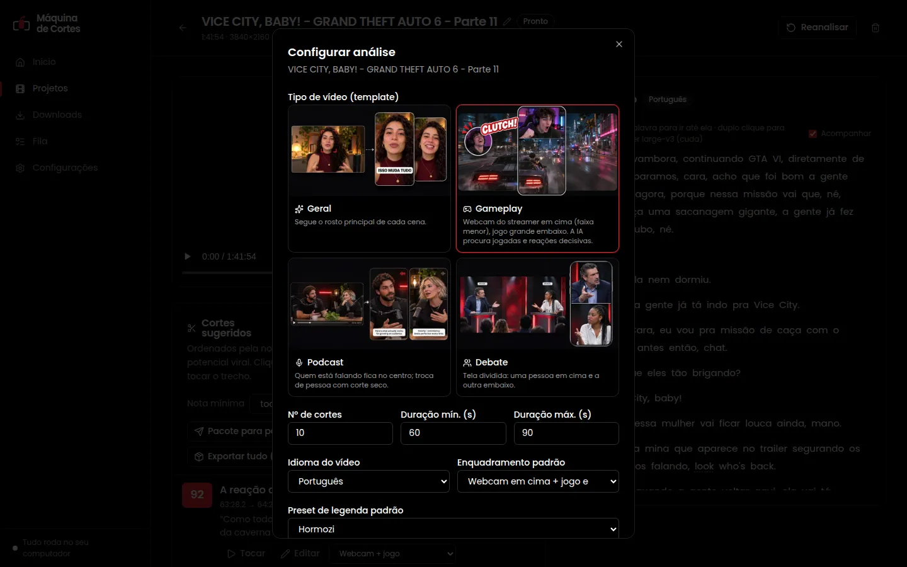
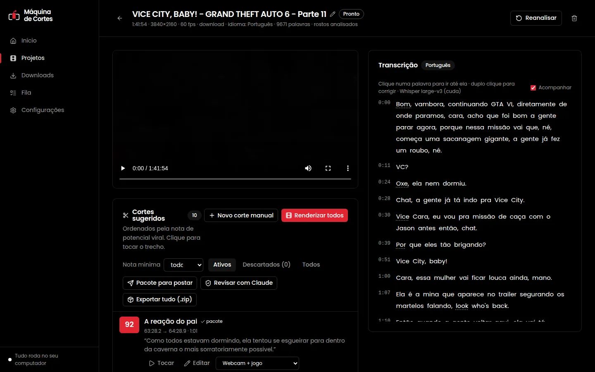
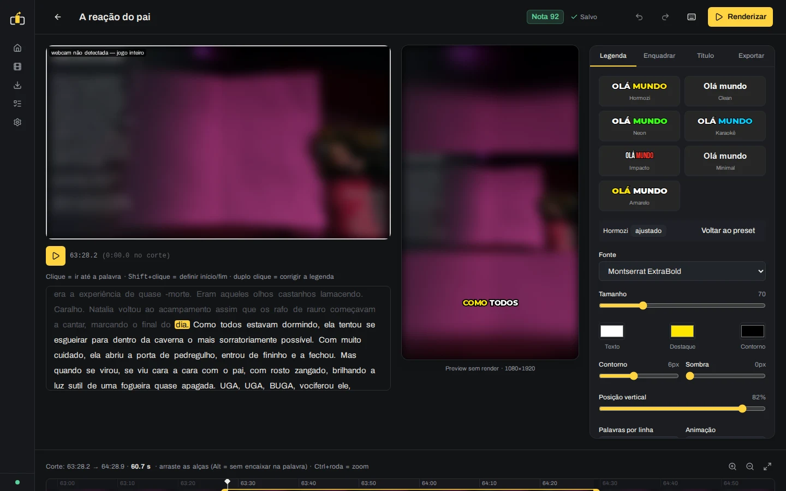
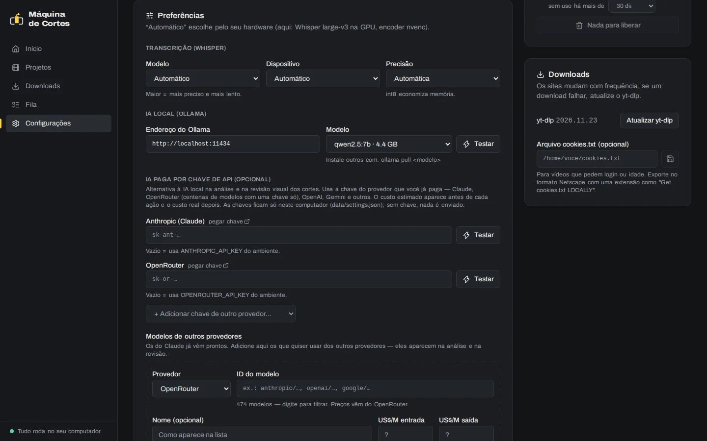
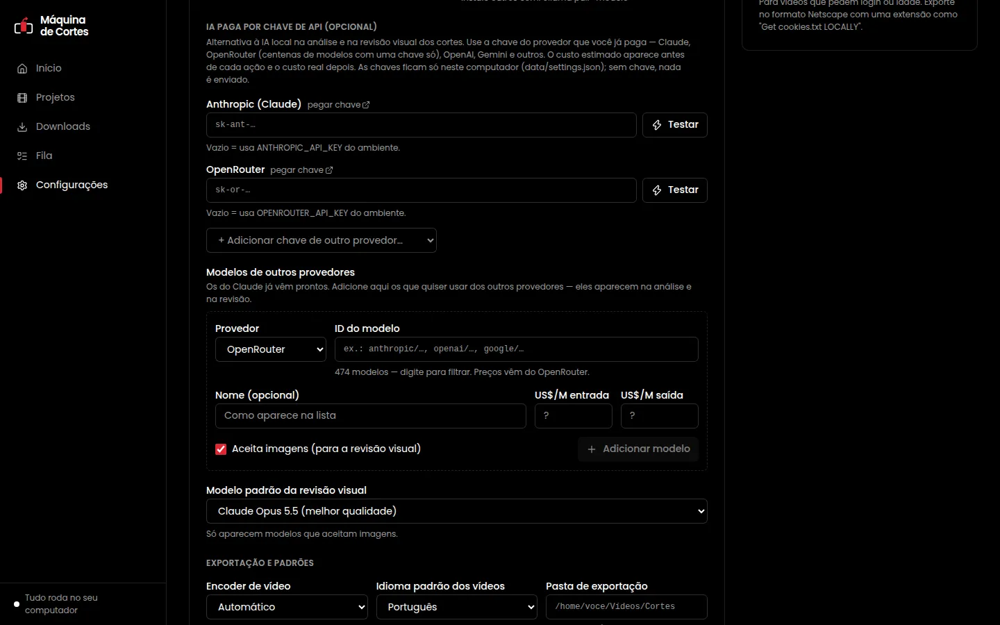
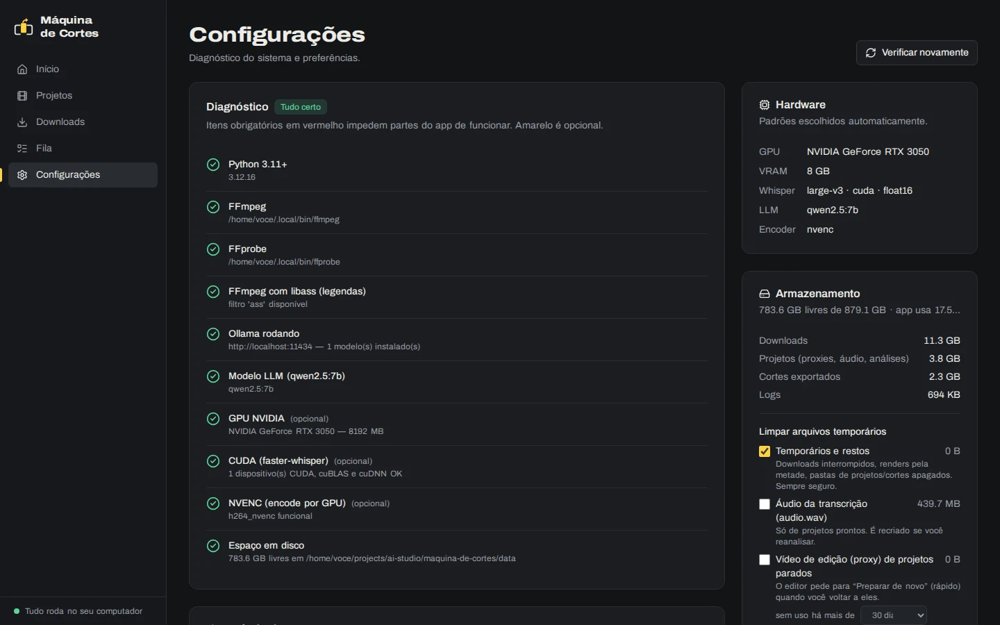
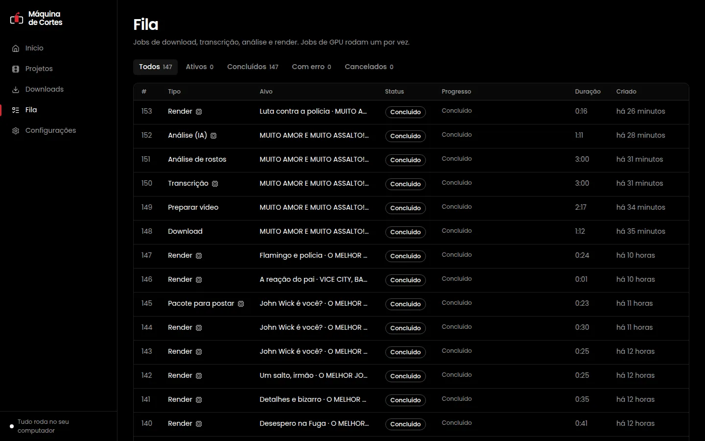

<div align="center">


# Máquina de Cortes ✂️

**Vídeo longo entra, cortes virais saem.**

Transforma podcasts, lives, aulas e gameplays em **cortes verticais (9:16) prontos para TikTok, Reels e Shorts**,
com legenda animada e enquadramento automático, **no seu computador**. É grátis e seus vídeos não vão para a internet.

[Instalar](#-instalação-passo-a-passo) · [Primeiro corte](#-seu-primeiro-corte-passo-a-passo) · [Modelos de IA](#-os-modelos-de-ia-explicados) · [Scripts](#-todos-os-scripts-e-comandos) · [Problemas?](#-quando-algo-dá-errado)

</div>



---

## Sumário

- [O que ela faz](#-o-que-ela-faz)
- [Por que rodar no seu computador?](#-por-que-rodar-no-seu-computador)
- [Do que você precisa](#-do-que-você-precisa)
- [Instalação passo a passo](#-instalação-passo-a-passo)
- [Quais modelos usar no meu PC? (script automático)](#-quais-modelos-usar-no-meu-pc)
- [Seu primeiro corte, passo a passo](#-seu-primeiro-corte-passo-a-passo)
- [O editor](#-o-editor)
- [Templates, enquadramento e legendas](#-templates-enquadramento-e-legendas)
- [Os modelos de IA explicados](#-os-modelos-de-ia-explicados)
- [IA paga (opcional)](#-ia-paga-opcional)
- [Todos os scripts e comandos](#-todos-os-scripts-e-comandos)
- [Quando algo dá errado](#-quando-algo-dá-errado)
- [Onde ficam os arquivos](#-onde-ficam-os-arquivos)
- [Atualizar e desinstalar](#-atualizar-e-desinstalar)
- [Perguntas frequentes](#-perguntas-frequentes)
- [Para desenvolvedores](#-para-desenvolvedores)
- [Uso responsável](#-uso-responsável)
- [Licença](#-licença)

---

## ✨ O que ela faz

1. **Baixa** o vídeo pelo link (YouTube, Twitch, TikTok, Instagram, X e centenas de outros sites) ou usa um arquivo que já está no seu computador.
2. **Transcreve** tudo o que é falado, palavra por palavra, com o horário exato de cada uma.
3. Uma **IA local lê a transcrição**, escolhe os melhores trechos e dá uma **nota de "potencial viral"** de 0 a 100 para cada um.
4. **Enquadra em 9:16** acompanhando o rosto de quem aparece, mostra quem está falando, divide a tela entre duas pessoas ou monta "webcam em cima + jogo embaixo".
5. Coloca **legendas animadas** palavra por palavra, no estilo que você escolher.
6. Você **ajusta** cada corte num editor visual e **exporta** o MP4 final.
7. A IA ainda escreve **título, legenda e hashtags** para cada rede e escolhe a **capa**.

Tudo isso numa interface no navegador, em português.

## 🔒 Por que rodar no seu computador?

- **Custo zero.** Sem assinatura e sem limite de minutos. As IAs rodam na sua máquina.
- **Privacidade.** O vídeo e a transcrição não saem do seu computador. (A internet só é usada para instalar e para baixar vídeos por link.)
- **Sem marca d'água.** O MP4 é seu.

> 💡 Se quiser, dá para usar **IAs pagas** (Claude, GPT, Gemini, OpenRouter…) com a sua chave. É totalmente opcional, o app sempre mostra o custo antes e nada é enviado sem você pedir. Veja [IA paga](#-ia-paga-opcional).

---

## 💻 Do que você precisa

| | Mínimo | Recomendado |
|---|---|---|
| **Sistema** | Linux 64 bits (Ubuntu 22.04 ou mais novo) | Ubuntu 24.04+ |
| **Memória RAM** | 8 GB | 16 GB |
| **Placa de vídeo** | nenhuma (roda no processador, só que mais devagar) | NVIDIA com 6 GB ou mais (ex.: RTX 2060, 3050, 3060, 4060) |
| **Espaço livre** | 20 GB | 50 GB ou mais (vídeos ocupam bastante) |
| **Internet** | só para instalar e baixar vídeos | |

> **Windows e macOS:** têm scripts próprios (veja [Windows](#windows) e [macOS](#macos)), mas foram **menos testados** que o Linux.

**Não sabe que placa de vídeo ou quanta memória você tem?** Não tem problema: o script [`sugerir-modelos`](#-quais-modelos-usar-no-meu-pc) descobre sozinho e diz o que usar.

### Quanto tempo demora?

Para um vídeo de **1 hora**, a análise completa (preparar + transcrever + IA escolher os cortes) leva mais ou menos:

| Computador | Tempo aproximado |
|---|---|
| NVIDIA de 8 GB (ex.: RTX 3050) | **~15 minutos** |
| NVIDIA de 4 GB | ~20–25 minutos |
| Só processador, 8 núcleos e 16 GB | ~50 minutos |
| Só processador, notebook simples | 1–2 horas |

Antes de começar, o app mostra uma **estimativa de tempo** para o seu vídeo e o seu computador. Depois de pronto, cada corte renderiza em 10–30 segundos com NVIDIA.

---

## 🚀 Instalação passo a passo

> Você só faz isso **uma vez**. Depois, para abrir o programa, basta o [passo 5](#5-abra-o-programa).

### Linux (Ubuntu e derivados)

#### 1. (Só para quem tem placa NVIDIA) Instale o driver

Se o seu computador tem placa de vídeo **NVIDIA**, instale o driver **antes** de tudo:

1. Abra o menu de aplicativos e procure **"Programas e Atualizações"** (*Software & Updates*).
2. Vá na aba **"Drivers adicionais"**.
3. Escolha o driver **`nvidia-driver-XXX`** marcado como *recomendado* (ou *proprietário, testado*).
4. Clique em **Aplicar alterações** e **reinicie o computador**.

Para conferir se deu certo, abra o Terminal e digite `nvidia-smi`. Se aparecer uma tabela com o nome da sua placa, está tudo certo.

> Sem NVIDIA? Pule este passo. O programa funciona assim mesmo, só que mais devagar.

#### 2. Baixe o projeto

**Opção A, sem saber nada de git (mais fácil):**

1. Na página do projeto no GitHub, clique no botão verde **`<> Code`** e depois em **Download ZIP**.
2. Extraia o ZIP (clique com o botão direito → **Extrair aqui**).
3. Dentro da pasta extraída, entre na pasta **`maquina-de-cortes`**.

**Opção B, com git:**

```bash
git clone https://github.com/Gustavo-2514/ai-studio.git
cd ai-studio/maquina-de-cortes
```

#### 3. Abra o Terminal dentro da pasta `maquina-de-cortes`

- Jeito mais fácil: abra a pasta `maquina-de-cortes` no gerenciador de arquivos, clique com o **botão direito num espaço vazio** e escolha **"Abrir no Terminal"**.
- Ou: abra o Terminal (`Ctrl` + `Alt` + `T`), digite `cd ` (com um espaço no final), **arraste a pasta `maquina-de-cortes` para dentro da janela** e aperte `Enter`.

Para conferir se está na pasta certa, digite `ls` e aperte `Enter`: devem aparecer `backend`, `frontend`, `scripts` e `run.py`.

#### 4. Rode o instalador

Copie a linha abaixo, cole no Terminal (`Ctrl` + `Shift` + `V`) e aperte `Enter`:

```bash
scripts/setup.sh
```

O instalador faz tudo sozinho, **sem pedir senha** (instala só dentro da sua pasta pessoal), e mostra o andamento em 5 etapas:

| Etapa | O que acontece |
|---|---|
| **1/5 Ferramentas** | instala o que faltar: Python (via `uv`), FFmpeg, Node.js e Ollama |
| **2/5 Ambiente Python** | instala as bibliotecas do programa numa pasta `.venv` |
| **3/5 Interface** | monta as telas do app |
| **4/5 Modelos de IA** | baixa o modelo de transcrição e o de IA **certos para o seu computador** (~8 GB na primeira vez) |
| **5/5 Diagnóstico** | confere se está tudo funcionando |

⏱️ Leva de **10 a 40 minutos**, dependendo da sua internet. Pode deixar rodando.

No final deve aparecer algo assim:

```text
  ✓ Python 3.11+: 3.12.x
  ✓ FFmpeg: /home/voce/.local/bin/ffmpeg
  ✓ Ollama rodando: http://localhost:11434 — 1 modelo(s) instalado(s)
  ✓ Modelo LLM (qwen2.5:7b): qwen2.5:7b
  ✓ GPU NVIDIA: NVIDIA GeForce RTX 3050 — 8192 MB
  ...
  Tudo pronto!
```

> **Internet lenta?** Use `scripts/setup.sh --sem-modelos`. Ele instala tudo menos os modelos, que baixam sozinhos no primeiro uso.
>
> **Apareceu "Precisa do zstd" ou "Precisa do curl"?** Rode `sudo apt install zstd curl` e depois `scripts/setup.sh` de novo.

#### 5. Abra o programa

```bash
scripts/start.sh
```

O navegador abre sozinho em **http://localhost:8000**. Se não abrir, digite esse endereço no navegador.

- **Para fechar:** volte ao Terminal e aperte `Ctrl` + `C`.
- **Para abrir de novo outro dia:** abra o Terminal na pasta (passo 3) e rode `scripts/start.sh`.
- **Não feche o Terminal** enquanto estiver usando o programa: é ele que mantém o app funcionando.

### Windows

> ⚠️ **Não testado.** O desenvolvimento foi feito no Linux. Se der problema, abra uma *issue* no GitHub.

1. (Se tiver NVIDIA) Atualize o driver pelo **GeForce Experience** ou em [nvidia.com/drivers](https://www.nvidia.com/Download/index.aspx).
2. Baixe o projeto (botão **Code → Download ZIP**) e extraia.
3. Abra a pasta `maquina-de-cortes`, clique na **barra de endereço** do Explorador, digite `powershell` e aperte `Enter`.
4. Rode o instalador (ele usa o `winget` para instalar FFmpeg, Node.js e Ollama):
   ```powershell
   powershell -ExecutionPolicy Bypass -File scripts\setup.ps1
   ```
5. Para abrir o programa, dê dois cliques em **`scripts\start.bat`** (ou rode `scripts\start.bat` no PowerShell).

### macOS

> ⚠️ **Pouco testado.** No Mac não existe NVIDIA: a transcrição roda no processador. No Mac com chip Apple (M1, M2, M3…), a IA de escolher cortes usa a GPU do chip.

1. Instale o [Homebrew](https://brew.sh) e depois, no Terminal: `brew install ffmpeg node`
2. Instale o Ollama: [ollama.com/download](https://ollama.com/download)
3. Na pasta `maquina-de-cortes`: `scripts/setup.sh` e depois `scripts/start.sh`.

---

## 🧠 Quais modelos usar no meu PC?

O programa usa **dois modelos de IA** que rodam no seu computador: um que **transcreve** (Whisper) e outro que **escolhe os cortes** (Ollama). Modelos maiores são melhores, mas precisam de mais memória.

Para não ter que adivinhar, rode:

```bash
scripts/sugerir-modelos.sh
```

> Windows: `scripts\sugerir-modelos.bat`. Funciona até **antes** de instalar (só precisa do Python).

Ele olha sua **placa de vídeo, memória RAM, processador e espaço em disco** e explica o que usar e por quê:

```text
Seu computador
  Sistema       Linux 7.0.0-44-generic
  Processador   AMD Ryzen 5 5600G with Radeon Graphics (12 núcleos)
  Memória RAM   14 GB
  Placa vídeo   NVIDIA GeForce RTX 3050 — 8 GB
  Disco livre   784 GB

Sugestão
  Transcrição (Whisper): large-v3  [placa de vídeo · float16 · ~3.1 GB]
     Por quê: a melhor precisão; cabe na sua placa e transcreve 1 hora de vídeo em poucos minutos.
     Alternativa: turbo — quase a mesma qualidade e ~2× mais rápido.
  IA que escolhe os cortes (Ollama): qwen2.5:7b  [~4.7 GB]
     Por quê: cabe inteiro na placa de vídeo (NVIDIA); é o modelo padrão e o mais testado com o app.
     Alternativa: qwen2.5:3b — se a análise ficar lenta ou faltar memória.
  Codificação do vídeo: nvenc (o app escolhe sozinho)

Próximos passos
  ✓ O modelo qwen2.5:7b já está instalado no Ollama.
  • Usar estes modelos no app: rode este script com --aplicar
```

Gostou da sugestão? Aplique com:

```bash
scripts/sugerir-modelos.sh --aplicar
```

Isso salva os modelos nas Configurações do app e pergunta se pode baixar o modelo de IA (se ainda não estiver instalado).

| Opção | O que faz |
|---|---|
| *(nenhuma)* | só mostra a sugestão, não muda nada |
| `--aplicar` | salva a sugestão no app e oferece baixar o modelo |
| `--aplicar --sim` | igual, mas sem perguntar (bom para automatizar) |
| `--json` | mostra tudo em JSON, para outros programas |

> O instalador e o app **já escolhem modelos automaticamente** pelo seu hardware. O script serve para você **entender** a escolha, ver alternativas e aproveitar placas maiores (por exemplo, sugerir o `qwen2.5:14b` numa placa de 16 GB ou mais).

### Tabela rápida de sugestões

| Seu computador | Transcrição (Whisper) | IA dos cortes (Ollama) |
|---|---|---|
| NVIDIA com 16 GB ou mais (RTX 4080, 4090, 3090…) | `large-v3` na placa | `qwen2.5:14b` |
| NVIDIA com 8–12 GB (RTX 3050 8 GB, 3060, 4060, 4070…) | `large-v3` na placa | `qwen2.5:7b` ⭐ padrão |
| NVIDIA com 6 GB (RTX 2060, 3050 6 GB…) | `large-v3` na placa | `qwen2.5:3b` (ou `7b`, um pouco mais lento) |
| NVIDIA com 4 GB (GTX 1650, 3050 notebook…) | `medium` na placa | `qwen2.5:3b` |
| Placa AMD (Linux) | `small` no processador | conforme a memória da placa |
| Mac com chip Apple, 16 GB+ | `small` no processador | `qwen2.5:7b` |
| Só processador, 16 GB de RAM | `small` | `qwen2.5:3b` |
| Só processador, 8 GB de RAM | `base` | `qwen2.5:3b` |
| Menos de 8 GB de RAM | `base` | `qwen2.5:1.5b` (ou [IA paga](#-ia-paga-opcional)) |

---

## 🎬 Seu primeiro corte, passo a passo

### Jeito mais rápido: pela tela Início

Na tela **Início**, cole o link do vídeo e clique em **Criar cortes**. O app baixa, transcreve e analisa sozinho. Também dá para **arrastar um arquivo de vídeo** para a caixa ou clicar em **Escolher arquivo**.

### Jeito completo: escolhendo a qualidade do download

**1. Baixe o vídeo.** Vá em **Downloads**, cole o link (pode ser mais de um, um por linha) e clique em **Analisar**. Escolha a qualidade e clique em **Baixar**. Playlists mostram a lista de vídeos para você escolher.



**2. Crie os cortes.** Quando o download terminar, clique em **Abrir projeto** (ou **Criar cortes**).

**3. Configure a análise.** Na janela **Configurar análise**, escolha:

- **Tipo de vídeo (template):** Geral, Gameplay, Podcast ou Debate ([o que muda?](#templates-escolha-pelo-tipo-de-vídeo));
- **Nº de cortes** e a **duração** mínima e máxima de cada um (em segundos);
- **Idioma do vídeo:** português, inglês, espanhol ou detectar automaticamente;
- **Estilo da legenda**;
- **Qual IA escolhe os cortes**: a local (grátis) ou uma [paga](#-ia-paga-opcional);
- **Instruções extras** (opcional), por exemplo: *"foque nas partes engraçadas"* ou *"evite falar de patrocinadores"*.

O app mostra o **tempo estimado** antes de começar. Clique em **Analisar**.



**4. Espere a análise.** Dá para acompanhar o progresso na página do projeto ou na **Fila**: preparar o vídeo → transcrever → a IA lê os trechos. Pode fechar a aba do navegador, o trabalho continua (só não feche o Terminal).

**5. Veja os cortes sugeridos.** Eles aparecem ordenados pela nota, do melhor para o pior. Clique em **Tocar** para assistir ao trecho e em **Por quê?** para ver o motivo da escolha. À direita fica a transcrição completa: clique em qualquer palavra para pular até ela.



**6. Ajuste no editor** (opcional). Clique em **Editar** para mudar início e fim, legenda, enquadramento e título. Veja [O editor](#-o-editor).

**7. Renderize.** Clique em **Renderizar** num corte ou em **Renderizar todos**. Depois use **Baixar** ou **Abrir pasta** para pegar os MP4.

**8. Pacote para postar.** Clique em **Pacote para postar**: a IA escreve **título, legenda e hashtags** para TikTok, Reels e Shorts e escolhe a **capa** de cada corte (o quadro mais nítido com rosto, numa versão limpa e outra com o título). Em cada corte, **Postar** mostra os textos (dá para editar) com um botão **Copiar** por plataforma.

**9. Exportar tudo (.zip).** Baixa os MP4 + as capas + `textos.csv` (abre no Excel ou Planilhas Google) + `textos.txt` (para copiar e colar).

> O app **não posta sozinho** em nenhuma rede social. Você posta quando e onde quiser.

### Outras formas de começar

- **Vídeo que já está no computador:** **Projetos → Novo projeto → Enviar arquivo**, ou **Caminho local** (não copia o arquivo, economiza espaço).
- **Corte do zero, escolhido por você:** na página do projeto, **Novo corte manual**.
- **Não gostou de um corte?** **Descartar** tira ele da lista (dá para recuperar em **Descartados**). **Duplicar** cria uma cópia para testar outra versão.

---

## 📝 O editor



O editor tem quatro áreas:

- **Esquerda:** o vídeo original e a transcrição do corte. Clique numa palavra para ir até ela, **Shift+clique** para marcar o início ou o fim e **duplo clique** para corrigir uma palavra errada da legenda.
- **Centro:** a prévia vertical (9:16) de como o corte vai ficar, já com a legenda.
- **Direita, abas:**
  - **Legenda:** escolha o estilo e ajuste fonte, tamanho, cores, contorno, sombra, posição, palavras por linha e animação.
  - **Enquadrar:** escolha o modo de enquadramento e ajuste à mão (arrastar e redimensionar).
  - **Título:** um texto fixo no topo do vídeo (opcional).
  - **Exportar:** opções do arquivo final.
- **Embaixo:** a linha do tempo com a forma de onda do áudio. Arraste as alças amarelas para mudar início e fim (elas "grudam" no começo das palavras; segure `Alt` para soltar). `Ctrl` + roda do mouse dá zoom.

O editor **salva sozinho** (aparece "Salvo" no topo). Quando terminar, clique em **Renderizar**.

### Atalhos do teclado

| Tecla | O que faz |
|---|---|
| `Espaço` | tocar / pausar |
| `←` / `→` | anda 1 quadro (com `Shift`: 1 segundo) |
| `I` / `O` | marca o início / o fim do corte onde o vídeo está |
| `J` / `K` / `L` | volta 2 s / pausa / toca (aperte `L` de novo para 2×) |
| `Ctrl+Z` / `Ctrl+Shift+Z` | desfazer / refazer |
| `Ctrl+S` | salvar agora |
| `Ctrl+Enter` | renderizar |
| `?` | mostra todos os atalhos |

---

## 🎨 Templates, enquadramento e legendas

### Templates: escolha pelo tipo de vídeo

O template muda **como o corte é enquadrado** e **o que a IA procura**:

| Template | Como fica o corte | O que a IA procura |
|---|---|---|
| **Geral** | segue o rosto principal | os melhores momentos em geral |
| **Gameplay** | webcam do streamer em cima, jogo grande embaixo | jogadas decisivas e reações fortes (gritos, risadas) |
| **Podcast** | quem está falando fica no centro, com corte seco na troca | opiniões fortes, histórias, frases de impacto |
| **Debate** | tela dividida: uma pessoa em cima, a outra embaixo | confrontos, réplicas, discordâncias |

### Modos de enquadramento

Cada corte pode usar um modo diferente (escolha na lista do corte ou na aba **Enquadrar** do editor):

| Modo | Quando usar |
|---|---|
| **Seguir rosto** | o padrão. Acompanha quem aparece e corta seco quando a câmera muda |
| **Quem fala no centro** | podcast/entrevista: lê o movimento dos lábios e mostra quem está falando |
| **Webcam + jogo** | gameplay com facecam (dá para arrastar e redimensionar a webcam e o jogo) |
| **Tela dividida** | duas pessoas na mesma cena: a da esquerda fica em cima, a da direita embaixo |
| **Inteiro + fundo borrado** | telas, slides e jogos sem webcam, onde não dá para cortar as laterais |
| **Centro** / **Manual** | quando você quer controlar o enquadramento |

### Estilos de legenda

**Hormozi**, **Clean**, **Neon**, **Karaokê**, **Impacto**, **Minimal** e **Amarelo**. Todos têm a palavra falada destacada em tempo real e podem ser ajustados no editor (fonte, cores, tamanho, posição, animação). O ajuste vale só para aquele corte; **Voltar ao preset** desfaz.

---

## 🤖 Os modelos de IA explicados

O app usa várias IAs pequenas, cada uma com uma tarefa. **Todas rodam no seu computador.**

| Tarefa | Modelo | Onde roda | Precisa baixar? |
|---|---|---|---|
| Transcrever a fala | **Whisper** (via [faster-whisper](https://github.com/SYSTRAN/faster-whisper)) | placa NVIDIA ou processador | sim, o instalador baixa |
| Escolher os cortes, dar notas, escrever textos para postar | **Qwen 2.5** (via [Ollama](https://ollama.com)) | placa de vídeo (NVIDIA, AMD, Apple) ou processador | sim, o instalador baixa |
| Achar rostos | **YuNet** (OpenCV) | processador | não, já vem junto |
| Saber quem está falando (lábios) | **MediaPipe Face Landmarker** | processador | não, já vem junto |
| Detectar troca de câmera | **PySceneDetect** | processador | não (não é IA, é análise de imagem) |

### Whisper: a transcrição

O Whisper ouve o áudio e escreve o que foi dito, com o horário de cada palavra. É isso que faz a legenda ficar sincronizada. Quanto maior o modelo, menos erros e mais lento.

| Modelo | Tamanho | Qualidade em português | Precisa de |
|---|---|---|---|
| `tiny` | 75 MB | fraca (muitos erros) | qualquer computador |
| `base` | 145 MB | razoável | qualquer computador |
| `small` | 0,5 GB | boa | ⭐ padrão sem NVIDIA |
| `medium` | 1,5 GB | muito boa | NVIDIA com 4 GB ou CPU forte (lento) |
| `turbo` | 1,6 GB | ótima, rápida | NVIDIA com 4 GB+ |
| `large-v3` | 3,1 GB | **a melhor** | ⭐ padrão com NVIDIA de 6 GB+ |

- **Dispositivo:** `cuda` = placa NVIDIA (rápido); `cpu` = processador. Placas AMD e Macs usam o processador para transcrever.
- **Precisão:** `float16` (melhor, na placa), `int8_float16` (economiza memória da placa), `int8` (no processador).
- No modo **Automático** o app escolhe sozinho. Se o modelo não conseguir carregar na placa (falta de memória, driver), o app usa o processador com o `small`.

### Ollama + Qwen 2.5: a IA que escolhe os cortes

O [Ollama](https://ollama.com) é um programa que roda modelos de linguagem (como um "ChatGPT" local). O app manda a transcrição para ele, em pedaços de ~8 minutos, e pede os trechos com mais potencial, com uma nota e o motivo. O mesmo modelo escreve os textos do **Pacote para postar**.

O modelo padrão é o **Qwen 2.5** (da Alibaba), escolhido por ser bom em português e por seguir bem o formato de resposta que o app espera.

| Modelo | Download | Qualidade dos cortes | Precisa de (memória da placa, ou RAM sem placa) |
|---|---|---|---|
| `qwen2.5:1.5b` | 1,0 GB | básica | 4 GB de RAM |
| `qwen2.5:3b` | 1,9 GB | boa | 6 GB na placa ou 8 GB de RAM |
| `qwen2.5:7b` | 4,7 GB | **muito boa** ⭐ padrão, a mais testada | 8 GB na placa |
| `qwen2.5:14b` | 9,0 GB | ótima | 16 GB na placa |
| `qwen2.5:32b` | 20 GB | excelente | 24–32 GB na placa |

> **Sobre a memória da placa:** o Whisper e o Qwen não precisam caber juntos. Em placas com menos de 10 GB, o app tira o Whisper da memória antes de chamar a IA (e o contrário também).

### Como trocar de modelo

**Pelo app:** **Configurações → Preferências**.

- **Transcrição (Whisper):** escolha o modelo, o dispositivo e a precisão. *Automático* decide pelo hardware.
- **IA local (Ollama):** a lista mostra os modelos instalados. Clique em **Testar** para ver se responde e quanto demora.



**Para instalar outro modelo no Ollama**, rode no Terminal (troque pelo nome do modelo):

```bash
ollama pull qwen2.5:3b
```

Depois ele aparece na lista em **Configurações**. Para ver os modelos instalados: `ollama list`. Para apagar um: `ollama rm qwen2.5:14b`.

> Outros modelos do [catálogo do Ollama](https://ollama.com/library) (Llama, Gemma, Mistral…) também funcionam, mas **não foram testados**. Se a análise der erro de "resposta inválida", volte para o Qwen 2.5.

**Ou use o script:** `scripts/sugerir-modelos.sh --aplicar` ([veja acima](#-quais-modelos-usar-no-meu-pc)).

### Codificação do vídeo final

Para gerar o MP4, o app usa **NVENC** (o chip de vídeo da placa NVIDIA, muito rápido) quando existe e funciona, e **x264** (processador) quando não. A qualidade é a mesma. O áudio é normalizado para −14 LUFS, o volume padrão das redes sociais.

---

## 💳 IA paga (opcional)

Se você já paga alguma IA ou quer resultados ainda melhores, dá para trocar a IA local por uma paga **em duas tarefas**:

1. **Escolher os cortes** (na janela **Configurar análise**, campo *IA que escolhe os cortes*);
2. **Revisão visual** dos cortes renderizados (**Revisar com Claude** / **Revisar**): a IA olha 8 quadros do MP4 final e aponta problemas como rosto cortado, legenda tapando algo, gancho fraco ou final no meio da frase.

Provedores suportados: **Anthropic (Claude)**, **OpenRouter** (centenas de modelos com uma chave só), **OpenAI**, **Google Gemini**, **DeepSeek**, **xAI (Grok)**, **Groq**, **Mistral** e **qualquer API compatível com a OpenAI** (LM Studio, Together…).



### Como configurar

1. Crie uma chave de API no site do provedor (o link **pegar chave** ao lado de cada campo leva direto para a página certa).
2. Em **Configurações → IA paga por chave de API**, cole a chave e clique em **Testar**.
3. Os modelos do **Claude** já vêm prontos. Para outros provedores, adicione o modelo em **Modelos de outros provedores** (no OpenRouter, digite para buscar: o preço vem sozinho).
4. Na hora de analisar, escolha o modelo na lista *IA que escolhe os cortes*.

### Custo e privacidade

- O app **mostra o custo estimado antes** de cada ação paga e o **custo real** depois. Para ter uma ideia, analisar um vídeo de 1 hora custa de **centavos** (modelos baratos, como o Claude Haiku) a **alguns reais** (os maiores).
- As chaves ficam **só no seu computador**, em `data/settings.json`. Também dá para usar variáveis de ambiente (`ANTHROPIC_API_KEY`, `OPENROUTER_API_KEY`, `OPENAI_API_KEY`, `GEMINI_API_KEY`…).
- Sem chave, **nada é enviado** para lugar nenhum. Com chave, só a transcrição (e, na revisão visual, os 8 quadros) vai para o provedor escolhido.

---

## 🧰 Todos os scripts e comandos

Rode sempre **dentro da pasta `maquina-de-cortes`**.

### Scripts principais

| Linux / macOS | Windows | Para que serve |
|---|---|---|
| `scripts/setup.sh` | `powershell -ExecutionPolicy Bypass -File scripts\setup.ps1` | instala tudo (rode de novo para atualizar) |
| `scripts/setup.sh --sem-modelos` | `... scripts\setup.ps1 -SemModelos` | instala sem baixar os modelos de IA |
| `scripts/start.sh` | `scripts\start.bat` | abre o programa em http://localhost:8000 |
| `scripts/sugerir-modelos.sh` | `scripts\sugerir-modelos.bat` | sugere os modelos de IA para o seu PC |
| `scripts/sugerir-modelos.sh --aplicar` | `scripts\sugerir-modelos.bat --aplicar` | aplica a sugestão e baixa o modelo |

### Comandos avançados (`run.py`)

O `start.sh` chama o `run.py`. Você também pode chamá-lo direto (Windows: troque `.venv/bin/python` por `.venv\Scripts\python.exe`):

| Comando | O que faz |
|---|---|
| `.venv/bin/python run.py` | abre o programa (igual ao `start.sh`) |
| `.venv/bin/python run.py --no-browser` | abre sem abrir o navegador (útil num servidor) |
| `.venv/bin/python run.py --diagnostico` | mostra o diagnóstico (FFmpeg, Ollama, placa…) e sai |
| `.venv/bin/python run.py --baixar-modelos` | baixa os modelos adequados ao hardware e sai |
| `.venv/bin/python run.py --dev` | modo desenvolvedor, com recarga automática (interface em http://localhost:5173) |

`scripts/start.sh` aceita as mesmas opções: `scripts/start.sh --no-browser`.

### Variáveis de ambiente (opcionais)

| Variável | Padrão | Para que serve |
|---|---|---|
| `MDC_PORT` | `8000` | porta do programa (ex.: `MDC_PORT=8001 scripts/start.sh`) |
| `MDC_HOST` | `127.0.0.1` | endereço. Use `0.0.0.0` para abrir de outro computador da rede (**cuidado**: não tem senha) |
| `MDC_DATA_DIR` | `./data` | pasta onde ficam vídeos, projetos e cortes (ex.: num HD externo) |
| `OLLAMA_HOST_URL` | `http://127.0.0.1:11434` | onde o Ollama está rodando |
| `ANTHROPIC_API_KEY`, `OPENROUTER_API_KEY`, `OPENAI_API_KEY`… | — | chaves da [IA paga](#-ia-paga-opcional), em vez de colar nas Configurações |

As variáveis que começam com `MDC_` também podem ficar num arquivo `.env` dentro da pasta `maquina-de-cortes` (uma por linha, ex.: `MDC_PORT=8001`).

---

## 🩺 Quando algo dá errado

**O primeiro lugar para olhar é Configurações → Diagnóstico.** Ele mostra ✅ ou ❌ para cada peça e diz como resolver. Os itens marcados como *opcional* não impedem o app de funcionar.



| Problema | Solução |
|---|---|
| `scripts/setup.sh: Permissão negada` | rode `chmod +x scripts/*.sh` e tente de novo |
| "Precisa do zstd" / "Precisa do curl" | `sudo apt install zstd curl` e rode o `setup.sh` de novo |
| Download do YouTube falha | **Configurações → Atualizar yt-dlp**, depois feche e abra o app |
| "O site pediu login" / restrição de idade | exporte um `cookies.txt` do navegador (extensão "Get cookies.txt LOCALLY") e informe o caminho em **Configurações → Downloads** |
| "A placa de vídeo ficou sem memória" | feche jogos e programas pesados, ou escolha modelos menores (rode `scripts/sugerir-modelos.sh`) |
| "O Ollama não está respondendo" | feche e abra o app (ele liga o Ollama sozinho); em **Configurações**, clique em **Testar** |
| A IA devolveu resposta inválida | tente de novo; se repetir, use um modelo maior ou volte para o `qwen2.5:7b` |
| Muito lento | sem NVIDIA tudo roda no processador. Use Whisper `small` ou `base` e `qwen2.5:3b` |
| A placa NVIDIA não aparece no Diagnóstico | instale o driver (veja a [instalação](#1-só-para-quem-tem-placa-nvidia-instale-o-driver)) e reinicie; confira com `nvidia-smi` |
| "Porta 8000 em uso" | o app já está aberto em outra janela, ou rode `MDC_PORT=8001 scripts/start.sh` e abra http://localhost:8001 |
| Disco cheio | **Configurações → Armazenamento → Liberar** |
| A página não abre | confira se o Terminal com o `start.sh` ainda está aberto e sem erro |

Cada tarefa com erro aparece na **Fila** com a explicação. Em **Detalhe técnico** está a mensagem completa, útil para pedir ajuda. Os registros ficam em `data/logs/`.



**Ainda com problema?** Abra uma *issue* no GitHub com: o sistema (Ubuntu 24.04, Windows 11…), a placa de vídeo, a saída de `.venv/bin/python run.py --diagnostico` e o **Detalhe técnico** do erro.

---

## 📁 Onde ficam os arquivos

Tudo fica dentro da pasta `data/` (ou na pasta definida em `MDC_DATA_DIR`):

| Pasta | Conteúdo |
|---|---|
| `data/downloads/` | vídeos baixados |
| `data/projects/` | arquivos de trabalho de cada projeto (dá para limpar em **Configurações → Armazenamento**) |
| `data/exports/` | **os cortes prontos (MP4)**, ou a pasta que você escolher em **Configurações** |
| `data/logs/` | registros para diagnóstico |
| `data/settings.json` | suas preferências (e chaves de API, se usar) |
| `data/app.db` | banco de dados com projetos e cortes |

Os modelos de IA ficam fora do projeto: o Whisper em `~/.cache/huggingface` e o Ollama em `~/.ollama/models`.

---

## 🔄 Atualizar e desinstalar

**Atualizar:**

- Se baixou com git: `git pull` dentro da pasta e depois `scripts/setup.sh`.
- Se baixou o ZIP: baixe o ZIP novo, **copie a sua pasta `data/`** para dentro da pasta nova e rode `scripts/setup.sh`.

**Desinstalar:**

1. Apague a pasta `maquina-de-cortes` (a pasta `data/` dentro dela tem seus vídeos e cortes: faça backup antes, se quiser).
2. Para remover também as ferramentas e os modelos: apague `~/.local/opt/` (FFmpeg, Node e Ollama instalados pelo setup), `~/.ollama/models` (modelos de IA) e `~/.cache/huggingface` (Whisper).

---

## ❓ Perguntas frequentes

**É grátis mesmo?**
Sim. Tudo roda no seu computador. Só é pago se você escolher usar uma [IA paga](#-ia-paga-opcional), com a sua própria chave.

**Preciso de internet?**
Só para instalar e para baixar vídeos por link. Com o vídeo no computador, dá para trabalhar offline.

**Meus vídeos vão para algum servidor?**
Não. Nada sai do seu computador, a não ser que você configure uma IA paga (aí só a transcrição vai para o provedor que você escolheu).

**Funciona sem placa de vídeo?**
Funciona, só demora mais. Rode `scripts/sugerir-modelos.sh` para escolher modelos leves.

**Ele posta nas redes sociais?**
Não. Ele prepara os vídeos, as capas e os textos. Você posta.

**Funciona com vídeos em inglês ou espanhol?**
Sim. Na análise dá para escolher português, inglês, espanhol ou **Detectar automaticamente**. A interface é em português.

**Qual o tamanho máximo do vídeo?**
Não tem limite fixo. Já foi usado com lives de quase 2 horas em 4K. Vídeos maiores só levam mais tempo e ocupam mais disco.

**Posso usar no celular?**
Não diretamente: o app roda no computador. Mas se abrir com `MDC_HOST=0.0.0.0`, dá para acessar pelo navegador de outro aparelho na mesma rede Wi-Fi (sem senha, então só em rede de confiança).

---

## 🔧 Para desenvolvedores

- **Backend:** Python 3.12, FastAPI + SQLite (SQLModel) + um worker próprio que roda as tarefas pesadas uma de cada vez na GPU (`backend/app`).
- **Frontend:** React + Vite + TypeScript + Tailwind (`frontend/src`).
- **Mídia:** FFmpeg (corte, legendas ASS via libass, NVENC), yt-dlp (downloads), faster-whisper (transcrição), Ollama (LLM), OpenCV YuNet + MediaPipe (rostos e lábios), PySceneDetect (cenas).

```text
maquina-de-cortes/
├── backend/app/
│   ├── api/          rotas HTTP (projetos, cortes, downloads, fila, sistema)
│   ├── services/     transcrição, IA, enquadramento, render, legendas, pacote para postar…
│   └── worker/       fila de tarefas (download, transcrição, análise, render)
├── frontend/src/     interface (páginas, editor, componentes)
├── scripts/          instaladores, inicialização e sugestão de modelos
├── docs/img/         prints usados neste README
└── run.py            sobe API + worker + Ollama juntos
```

- **Modo desenvolvimento** (recarga automática): `.venv/bin/python run.py --dev` → interface em http://localhost:5173.
- **Testes:** `cd backend && ../.venv/bin/pytest` e `cd frontend && npm test`.
- **Decisões de implementação e medições:** [`DECISIONS.md`](DECISIONS.md). Especificação original: [`../MAQUINA_DE_CORTES.md`](../MAQUINA_DE_CORTES.md). Ideias e roteiro: [`../ideias-de-novas-features.md`](../ideias-de-novas-features.md).

Contribuições são bem-vindas: abra uma *issue* para conversar sobre a ideia ou mande um *pull request*. Testes no Windows e no macOS ajudam muito.

---

## 🤝 Uso responsável

Baixe e corte apenas conteúdo que você tem direito de usar: seu, com licença ou com permissão do criador. Muitas plataformas só monetizam cortes de terceiros com autorização, e alguns criadores têm regras próprias para canais de cortes.

---

## 📄 Licença

[MIT](../LICENSE): pode usar, modificar e distribuir, inclusive comercialmente, desde que mantenha o aviso de copyright.
As mudanças de cada versão estão no [CHANGELOG](../CHANGELOG.md).

---

<div align="center">

Feito por [Gustavo Albuquerque](https://github.com/Gustavo-2514).
Se o projeto te ajudou, deixe uma ⭐ no GitHub!

</div>
